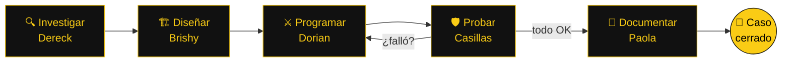
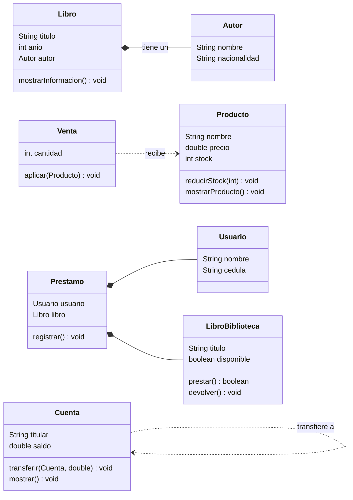

<a name="inicio"></a>

<div align="center">


<p>


</p>
<p>


</p>

**La noche es oscura. La lógica debe estar clara.**


[🦇 Expediente](#-el-expediente--sobre-esta-práctica) ·
[🦸 Batfamilia](#-la-batfamilia--integrantes-y-roles) ·
[🗺️ Mapa](#️-mapa-de-gotham--los-18-expedientes) ·
[🌃 Distrito 1](#-distrito-1--casos-de-la-vida-real) ·
[🌉 Distrito 2](#-distrito-2--fundamentos-de-métodos) ·
[🏙️ Distrito 3](#️-distrito-3--objetos-que-colaboran) ·
[🧠 Conceptos](#-batcinturón--conceptos-aplicados) ·
[⚙️ Ejecución](#️-activando-la-batcomputadora) ·
[🃏 Villanos](#-galería-de-villanos)

</div>


## 🦇 El expediente · Sobre esta práctica

Esta es la **Guía APE 4: Clases, Objetos y Métodos** de Algoritmos y Lógica de Programación. Gotham quedó dividida en **tres distritos** y cada uno guarda sus propios casos:

| Distrito | Caso | Expedientes | Lo que se investiga |
| :---: | :--- | :---: | :--- |
| 🌃 **1** | **Casos de la vida real** | 5 | Arreglos de objetos, contadores, ciclos y referencias |
| 🌉 **2** | **Fundamentos de métodos** | 8 | Tipos de retorno, `void`, parámetros, paso por valor y validaciones |
| 🏙️ **3** | **Objetos que colaboran** | 5 | Objetos como atributos, como parámetros y clases que trabajan juntas |

> [!NOTE]
> **Objetivo de la misión:** desarrollar programas usando clases, objetos y métodos para disminuir errores y reutilizar el código. Así como Batman no sale sin su cinturón, ningún objeto sale sin su clase.

<div align="center">


</div>

## 🦸 La Batfamilia · Integrantes y roles

| N.º | BatIntegrante | BatOperación | BatObjetivo |
| :---: | :--- | :--- | :--- |
| 🔍 **1** | **Paredes Acosta Dereck Shair** | **Detective del Código Oscuro** · Investigar · Analista | Identificar los datos de entrada, las condiciones y el resultado esperado de cada caso. |
| 🏗️ **2** | **Ashanga Yumbo Brishy Anahy** | **Arquitecta de la Baticueva Digital** · Preparar · Diseñar | Organizar una secuencia lógica de solución antes de escribir código. |
| ⚔️ **3** | **Calderón Carvajal Fher Dorian** | **Caballero del Backend** · Construir · Programar | Transformar el diseño en instrucciones claras, comprensibles y ordenadas. |
| 🛡️ **4** | **Casillas Ochoa Antony Sebastián** | **Guardián Nocturno del Testing** · Inspeccionar · Probar | Revisar casos normales, entradas inválidas y situaciones límite. |
| 📜 **5** | **Sánchez Bastidas Karina Paola** | **Oráculo del Conocimiento** · Archivar · Documentar | Explicar el funcionamiento, las decisiones y lo aprendido. |

<div align="center">

**Agentes que han dejado huella en la Baticueva**

<a href="https://github.com/brishy769-coder/SW-AyLP-APE-04-Clases-Objetos-y-Metodos/graphs/contributors">
  
</a>

</div>

### 🔦 Protocolo de la Baticueva



> [!IMPORTANT]
> **Regla de la Baticueva:** ningún caso se cierra solo porque «en mi computadora sí funciona».


## 🗺️ Mapa de Gotham · Los 18 expedientes

<table>
<tr>
<td valign="top" width="33%">

**🌃 Distrito 1**
1. [📝 Notas del curso](./Grupo%201/Ejercicio%201/)
2. [🛒 Inventario de tienda](./Grupo%201/Ejercicio%202/)
3. [🐾 Veterinaria](./Grupo%201/Ejercicio%203/)
4. [💰 Cuenta de ahorro](./Grupo%201/Ejercicio%204/)
5. [📚 Biblioteca](./Grupo%201/Ejercicio%205/)

</td>
<td valign="top" width="33%">

**🌉 Distrito 2**
1. [📐 Tipos de retorno](./Grupo%202/Ejercicio%201/)
2. [👋 Bienvenida](./Grupo%202/Ejercicio%202/)
3. [🎯 Parámetros y argumentos](./Grupo%202/Ejercicio%203/)
4. [📦 Paso por valor](./Grupo%202/Ejercicio%204/)
5. [🧮 Promedio](./Grupo%202/Ejercicio%205/)
6. [✅ Validar edad](./Grupo%202/Ejercicio%206/)
7. [🏷️ Clase Producto](./Grupo%202/Ejercicio%207/)
8. [🚀 Instanciación](./Grupo%202/Ejercicio%208/)

</td>
<td valign="top" width="33%">

**🏙️ Distrito 3**
1. [📖 Libro y Autor](./Grupo%203/Ejercicio%201/)
2. [▭ Rectángulo](./Grupo%203/Ejercicio%202/)
3. [🧾 Producto y Venta](./Grupo%203/Ejercicio%203/)
4. [💸 Transferencias](./Grupo%203/Ejercicio%204/)
5. [🏛️ Préstamo de libros](./Grupo%203/Ejercicio%205/)

</td>
</tr>
</table>

<div align="center">

</div>

## 🌃 Distrito 1 · Casos de la vida real

> *Arreglos de objetos, contadores, ciclos y referencias. Los casos que pasan todos los días en Gotham.*

### 📝 Expediente 1.1 · Notas del curso

| 🔎 Pista | 📂 Detalle |
| :--- | :--- |
| **Archivo** | [`NotasCurso.java`](./Grupo%201/Ejercicio%201/NotasCurso.java) |
| **Clases** | Estudiante · NotasCurso |
| **Qué se investiga** | Arreglo de 5 objetos `Estudiante`: promedio de 3 notas redondeado, estado (Aprobado, Supletorio o Reprobado) y conteo de aprobados. |
| **Datos de prueba** | 5 estudiantes |
| **Resultado** | Valeria `8.83 Aprobado` · aprobados: `3` |

<details>
<summary><b>🖥️ Ver salida en la Batcomputadora</b></summary>

```text
Valeria Castro : 8.83 Aprobado
Javier Yanez : 5.17 Supletorio
Gabriela Nunez : 4.17 Reprobado
Kevin Moreta : 7.0 Aprobado
Lucia Haro : 7.17 Aprobado
==============================
Total de aprobados: 3
```

</details>

<details>
<summary><b>📸 Ver evidencia de ejecución</b></summary>
<br>
<p align="center"></p>
</details>

---

### 🛒 Expediente 1.2 · Inventario de una tienda

| 🔎 Pista | 📂 Detalle |
| :--- | :--- |
| **Archivo** | [`InventarioTienda.java`](./Grupo%201/Ejercicio%202/InventarioTienda.java) |
| **Clases** | Producto · InventarioTienda |
| **Qué se investiga** | Vender unidades solo si hay stock, marcar `-> Reponer` cuando quedan menos de 5 y sumar el valor del inventario. |
| **Datos de prueba** | Se venden 3 esferos y 3 borradores |
| **Resultado** | Borrador y Carpeta con `-> Reponer` · total `$54.25` |

<details>
<summary><b>🖥️ Ver salida en la Batcomputadora</b></summary>

```text
>> Lista de productos
Cuaderno : 2.5
Esfero : 0.6
Borrador : 0.35
Carpeta : 1.75

Venta: 3 unidades de Esfero
Venta: 3 unidades de Borrador

>> Estado del stock
Cuaderno : 2.5 (quedan 12)
Esfero : 0.6 (quedan 27)
Borrador : 0.35 (quedan 3) -> Reponer
Carpeta : 1.75 (quedan 4) -> Reponer

Valor total del inventario: $54.25
```

</details>

<details>
<summary><b>📸 Ver evidencia de ejecución</b></summary>
<br>
<p align="center"></p>
</details>

---

### 🐾 Expediente 1.3 · Veterinaria

| 🔎 Pista | 📂 Detalle |
| :--- | :--- |
| **Archivo** | [`Veterinaria.java`](./Grupo%201/Ejercicio%203/Veterinaria.java) |
| **Clases** | Mascota · Veterinaria |
| **Qué se investiga** | Alerta de peso mayor a 20 kg y la prueba de que `Mascota m4 = m1;` copia la referencia y no crea otra mascota. |
| **Datos de prueba** | Toby, Nala y Coco; `m4 = m1` |
| **Resultado** | `m1.edad` pasa de `4` a `5` |

<details>
<summary><b>🖥️ Ver salida en la Batcomputadora</b></summary>

```text
Registro de mascotas (peso en kg)
Toby : Perro : 22.3   <-- Revisar peso
Nala : Gato : 3.8
Coco : Conejo : 1.9

m1.edad al inicio = 4
m1.edad luego de modificar m4 = 5
```

</details>

<details>
<summary><b>📸 Ver evidencia de ejecución</b></summary>
<br>
<p align="center"></p>
</details>

---

### 💰 Expediente 1.4 · Cuenta de ahorro

| 🔎 Pista | 📂 Detalle |
| :--- | :--- |
| **Archivo** | [`CuentaAhorro.java`](./Grupo%201/Ejercicio%204/CuentaAhorro.java) |
| **Clases** | Cuenta · CuentaAhorro |
| **Qué se investiga** | Un `while` que deposita 50 cada mes hasta llegar a la meta de 500 y cuenta los meses. |
| **Datos de prueba** | Sofía 200 · Mateo 350 |
| **Resultado** | `6` meses y `3` meses |

<details>
<summary><b>🖥️ Ver salida en la Batcomputadora</b></summary>

```text
Ahorro de Sofia Guaman (inicia con 200.0)
  Mes 1 -> Sofia Guaman : 250.0
  Mes 2 -> Sofia Guaman : 300.0
  Mes 3 -> Sofia Guaman : 350.0
  Mes 4 -> Sofia Guaman : 400.0
  Mes 5 -> Sofia Guaman : 450.0
  Mes 6 -> Sofia Guaman : 500.0
Ahorro de Mateo Lema (inicia con 350.0)
  Mes 1 -> Mateo Lema : 400.0
  Mes 2 -> Mateo Lema : 450.0
  Mes 3 -> Mateo Lema : 500.0

Resumen:
Sofia Guaman llego a la meta en 6 meses
Mateo Lema llego a la meta en 3 meses
```

</details>

<details>
<summary><b>📸 Ver evidencia de ejecución</b></summary>
<br>
<p align="center"></p>
</details>

---

### 📚 Expediente 1.5 · Biblioteca

| 🔎 Pista | 📂 Detalle |
| :--- | :--- |
| **Archivo** | [`Biblioteca.java`](./Grupo%201/Ejercicio%205/Biblioteca.java) |
| **Clases** | Libro · Socio · Biblioteca |
| **Qué se investiga** | `prestar(Libro)` cambia la disponibilidad del libro y cuenta los préstamos de cada socio. |
| **Datos de prueba** | Camila pide 2, Diego 1 |
| **Resultado** | Queda `1` libro disponible |

<details>
<summary><b>🖥️ Ver salida en la Batcomputadora</b></summary>

```text
*** Estado de los libros ***
El Alquimista : Prestado
Rayuela : Prestado
Ficciones : Prestado
Pedro Paramo : Disponible
*** Socios ***
Camila Ortiz : 2
Diego Pilco : 1
Quedan 1 libro(s) disponible(s)
```

</details>

<details>
<summary><b>📸 Ver evidencia de ejecución</b></summary>
<br>
<p align="center"></p>
</details>


<div align="center">

</div>

## 🌉 Distrito 2 · Fundamentos de métodos

> *Ocho interrogatorios cortos. Cada método tiene que confesar qué recibe y qué devuelve.*

### 📐 Expediente 2.1 · Tipos de retorno

| 🔎 Pista | 📂 Detalle |
| :--- | :--- |
| **Archivo** | [`Area.java`](./Grupo%202/Ejercicio%201/Area.java) |
| **Clases** | Area |
| **Qué se investiga** | El método declaraba `int` y no tenía `return`. Se corrige con `double` y `return area`. |
| **Datos de prueba** | Base 4.5 · altura 3.0 |
| **Resultado** | `13.5` |

<details>
<summary><b>🖥️ Ver salida en la Batcomputadora</b></summary>

```text
El área es: 13.5
```

</details>

<details>
<summary><b>📸 Ver evidencia de ejecución</b></summary>
<br>
<p align="center"></p>
</details>

---

### 👋 Expediente 2.2 · Métodos void

| 🔎 Pista | 📂 Detalle |
| :--- | :--- |
| **Archivo** | [`Bienvenida.java`](./Grupo%202/Ejercicio%202/Bienvenida.java) |
| **Clases** | Bienvenida |
| **Qué se investiga** | Un método `void` que recibe nombre y edad e imprime el saludo: solo actúa, no devuelve nada. |
| **Datos de prueba** | Antony, 19 |
| **Resultado** | `Hola Antony, tienes 19 años...` |

<details>
<summary><b>🖥️ Ver salida en la Batcomputadora</b></summary>

```text
Hola Antony, tienes 19 años. ¡Bienvenido al sistema!
```

</details>

<details>
<summary><b>📸 Ver evidencia de ejecución</b></summary>
<br>
<p align="center"></p>
</details>

---

### 🎯 Expediente 2.3 · Parámetros y argumentos

| 🔎 Pista | 📂 Detalle |
| :--- | :--- |
| **Archivo** | [`Calculadora.java`](./Grupo%202/Ejercicio%203/Calculadora.java) |
| **Clases** | Calculadora |
| **Qué se investiga** | `x` e `y` son parámetros (la firma); `4.0` y `5.5` son argumentos (la llamada). |
| **Datos de prueba** | multiplicar(4.0, 5.5) |
| **Resultado** | `22.0` |

<details>
<summary><b>🖥️ Ver salida en la Batcomputadora</b></summary>

```text
Resultado: 22.0
```

</details>

<details>
<summary><b>📸 Ver evidencia de ejecución</b></summary>
<br>
<p align="center"></p>
</details>

---

### 📦 Expediente 2.4 · Paso por valor

| 🔎 Pista | 📂 Detalle |
| :--- | :--- |
| **Archivo** | [`PasoPorValor.java`](./Grupo%202/Ejercicio%204/PasoPorValor.java) |
| **Clases** | PasoPorValor |
| **Qué se investiga** | `n` recibe una copia de `numero`; sumarle 5 dentro del método no cambia la variable del `main`. |
| **Datos de prueba** | numero = 10 |
| **Resultado** | Se imprime `10` |

<details>
<summary><b>🖥️ Ver salida en la Batcomputadora</b></summary>

```text
10
```

</details>

<details>
<summary><b>📸 Ver evidencia de ejecución</b></summary>
<br>
<p align="center"></p>
</details>

---

### 🧮 Expediente 2.5 · Método con varios parámetros

| 🔎 Pista | 📂 Detalle |
| :--- | :--- |
| **Archivo** | [`Calculadora.java`](./Grupo%202/Ejercicio%205/Calculadora.java) |
| **Clases** | Calculadora |
| **Qué se investiga** | `calcularPromedio(n1, n2, n3)` recibe tres notas y retorna el promedio. |
| **Datos de prueba** | Notas 8, 9 y 10 |
| **Resultado** | `9.0` |

<details>
<summary><b>🖥️ Ver salida en la Batcomputadora</b></summary>

```text
Promedio: 9.0
```

</details>

<details>
<summary><b>📸 Ver evidencia de ejecución</b></summary>
<br>
<p align="center"></p>
</details>

---

### ✅ Expediente 2.6 · Validación de edad

| 🔎 Pista | 📂 Detalle |
| :--- | :--- |
| **Archivo** | [`ValidacionEdad.java`](./Grupo%202/Ejercicio%206/ValidacionEdad.java) |
| **Clases** | ValidacionEdad |
| **Qué se investiga** | `verificarEdad` imprime `Edad inválida` y retorna `false` si la edad está fuera de 0 a 120. |
| **Datos de prueba** | Edad 19 |
| **Resultado** | `Edad válida: true` |

<details>
<summary><b>🖥️ Ver salida en la Batcomputadora</b></summary>

```text
Edad válida: true
```

</details>

<details>
<summary><b>📸 Ver evidencia de ejecución</b></summary>
<br>
<p align="center"></p>
</details>

---

### 🏷️ Expediente 2.7 · Completar la clase Producto

| 🔎 Pista | 📂 Detalle |
| :--- | :--- |
| **Archivo** | [`Producto.java`](./Grupo%202/Ejercicio%207/Producto.java) |
| **Clases** | Producto |
| **Qué se investiga** | Los espacios vacíos eran `double` (tipo de retorno) y `return`. |
| **Datos de prueba** | Stock 10 · precio 25.5 |
| **Resultado** | `255.0` |

<details>
<summary><b>🖥️ Ver salida en la Batcomputadora</b></summary>

```text
Valor del inventario: 255.0
```

</details>

<details>
<summary><b>📸 Ver evidencia de ejecución</b></summary>
<br>
<p align="center"></p>
</details>

---

### 🚀 Expediente 2.8 · Instanciación en el main

| 🔎 Pista | 📂 Detalle |
| :--- | :--- |
| **Archivo** | [`Principal.java`](./Grupo%202/Ejercicio%208/Principal.java) |
| **Clases** | Producto · Principal |
| **Qué se investiga** | Crear `p` con `new`, asignar sus atributos, llamar a `calcularValorTotal()` y guardar el resultado. |
| **Datos de prueba** | Stock 10 · precio 25.5 |
| **Resultado** | `Total del inventario: 255.0` |

<details>
<summary><b>🖥️ Ver salida en la Batcomputadora</b></summary>

```text
Total del inventario: 255.0
```

</details>

<details>
<summary><b>📸 Ver evidencia de ejecución</b></summary>
<br>
<p align="center"></p>
</details>


<div align="center">

</div>

## 🏙️ Distrito 3 · Objetos que colaboran

> *Ningún héroe trabaja solo. Aquí las clases se pasan objetos, se guardan unas dentro de otras y resuelven el caso en equipo.*

### 🕸️ Red de sospechosos · Diagrama de clases



> [!TIP]
> En el diagrama, `LibroBiblioteca` es la clase `Libro` del ejercicio 5. Se renombró solo aquí para no confundirla con el `Libro` del ejercicio 1.

### 📖 Expediente 3.1 · Libro y Autor

| 🔎 Pista | 📂 Detalle |
| :--- | :--- |
| **Archivo** | [`MainEj1.java`](./Grupo%203/Ejercicio%201/MainEj1.java) |
| **Clases** | Autor · Libro · MainEj1 |
| **Qué se investiga** | **Objeto como atributo:** `Libro` guarda un `Autor` completo y lo muestra con `mostrarInformacion()`. |
| **Datos de prueba** | Cien años de soledad · Don Quijote |
| **Resultado** | Título, año y autor de cada libro |

<details>
<summary><b>🖥️ Ver salida en la Batcomputadora</b></summary>

```text
Titulo: Cien años de soledad
Año: 1967
Autor: Gabriel Garcia Marquez

Titulo: Don Quijote
Año: 1605
Autor: Miguel de Cervantes
```

</details>

<details>
<summary><b>📸 Ver evidencia de ejecución</b></summary>
<br>
<p align="center"></p>
</details>

---

### ▭ Expediente 3.2 · Rectángulo

| 🔎 Pista | 📂 Detalle |
| :--- | :--- |
| **Archivo** | [`MainEj2.java`](./Grupo%203/Ejercicio%202/MainEj2.java) |
| **Clases** | Rectangulo · MainEj2 |
| **Qué se investiga** | **Firmas de métodos:** `double`, `boolean`, `String` y `void`, cada uno donde corresponde. |
| **Datos de prueba** | 4.0 x 6.0 · 5.0 x 5.0 |
| **Resultado** | Áreas `24.0` y `25.0` · `false` y `true` |

<details>
<summary><b>🖥️ Ver salida en la Batcomputadora</b></summary>

```text
Rectangulo de 4.0 x 6.0
Area: 24.0
Perimetro: 20.0
Es cuadrado: false

Rectangulo de 5.0 x 5.0
Area: 25.0
Perimetro: 20.0
Es cuadrado: true
```

</details>

<details>
<summary><b>📸 Ver evidencia de ejecución</b></summary>
<br>
<p align="center"></p>
</details>

---

### 🧾 Expediente 3.3 · Producto y Venta

| 🔎 Pista | 📂 Detalle |
| :--- | :--- |
| **Archivo** | [`MainEj3.java`](./Grupo%203/Ejercicio%203/MainEj3.java) |
| **Clases** | Producto · Venta · MainEj3 |
| **Qué se investiga** | **Objeto como parámetro:** `aplicar(Producto)` baja el stock solo si alcanza y muestra el total. |
| **Datos de prueba** | Teclado $15, stock 10; ventas de 3 y 20 |
| **Resultado** | `$45.0`, stock `7` · luego `Stock insuficiente.` |

<details>
<summary><b>🖥️ Ver salida en la Batcomputadora</b></summary>

```text
Total a pagar: $45.0
Producto: Teclado
Precio: $15.0
Stock: 7

Stock insuficiente.
```

</details>

<details>
<summary><b>📸 Ver evidencia de ejecución</b></summary>
<br>
<p align="center"></p>
</details>

---

### 💸 Expediente 3.4 · Transferencias

| 🔎 Pista | 📂 Detalle |
| :--- | :--- |
| **Archivo** | [`MainEj4.java`](./Grupo%203/Ejercicio%204/MainEj4.java) |
| **Clases** | Cuenta · MainEj4 |
| **Qué se investiga** | **Objeto como parámetro:** `transferir(Cuenta destino, double monto)` solo mueve dinero si hay fondos. |
| **Datos de prueba** | Carlos $100 · Pedro $50; 30 y 200 |
| **Resultado** | Primera exitosa, segunda falla · `$70` y `$80` |

<details>
<summary><b>🖥️ Ver salida en la Batcomputadora</b></summary>

```text
Transferencia exitosa.

Transferencia fallida: fondos insuficientes o monto invalido.

Titular: Carlos
Saldo: $70.0
Titular: Pedro
Saldo: $80.0
```

</details>

<details>
<summary><b>📸 Ver evidencia de ejecución</b></summary>
<br>
<p align="center"></p>
</details>

---

### 🏛️ Expediente 3.5 · Préstamo de libros

| 🔎 Pista | 📂 Detalle |
| :--- | :--- |
| **Archivo** | [`MainEj5.java`](./Grupo%203/Ejercicio%205/MainEj5.java) |
| **Clases** | Usuario · Libro · Prestamo · MainEj5 |
| **Qué se investiga** | **Colaboración entre clases:** dos usuarios piden el mismo libro y solo el primero lo consigue. |
| **Datos de prueba** | Carlos y María |
| **Resultado** | `El libro no esta disponible para Maria` |

<details>
<summary><b>🖥️ Ver salida en la Batcomputadora</b></summary>

```text
Prestamo registrado correctamente.
Usuario: Carlos
Libro: Java para principiantes

El libro no esta disponible para Maria
```

</details>

<details>
<summary><b>📸 Ver evidencia de ejecución</b></summary>
<br>
<p align="center"></p>
</details>


## 🧠 Batcinturón · Conceptos aplicados

<table>
<tr>
<td width="50%" valign="top">

| Gadget | Para qué sirve |
| :--- | :--- |
| 🦇 **Clase** | El plano del Batimóvil |
| 🚗 **Objeto (`new`)** | El Batimóvil ya construido |
| 🔧 **Atributos** | Sus características |
| 🏭 **Constructor + `this`** | La línea de ensamblaje |
| ⚡ **Métodos** | Lo que el Batimóvil sabe hacer |

</td>
<td width="50%" valign="top">

| Gadget | Para qué sirve |
| :--- | :--- |
| 📥 **Parámetros / argumentos** | Las pistas que recibe y las que se envían |
| 🔙 **`return` / `void`** | Devolver evidencia o solo actuar |
| 📋 **Copia (paso por valor)** | Un `int` viaja como fotocopia |
| 🔗 **Referencia** | Dos nombres, un solo objeto |
| 🤝 **Colaboración** | Objetos dentro de objetos |

</td>
</tr>
</table>

<details>
<summary><b>🔬 Prueba de laboratorio: ¿copia o referencia?</b></summary>

<br>

```java
int numero = 10;
ejemplo.incrementar(numero);   // dentro: n = n + 5
System.out.println(numero);    // 10  -> viajó una copia

Mascota m4 = m1;               // sin new: no hay otra mascota
m4.edad = m4.edad + 1;
System.out.println(m1.edad);   // 5   -> m1 y m4 son el mismo objeto
```

Un `int` se pasa como fotocopia. Una variable de objeto guarda la dirección del objeto, así que dos variables pueden apuntar al mismo Batimóvil.

</details>


## ⚙️ Activando la Batcomputadora

### 🖥️ Desde un IDE (NetBeans, VS Code, IntelliJ)

1. Clonar o descargar el repositorio.
2. Abrir la carpeta del ejercicio, por ejemplo `Grupo 3/Ejercicio 1`.
3. Abrir el `.java` que tiene `public static void main(String[] args)`.
4. Ejecutar: **Shift + F6** en NetBeans o **Run** en VS Code.
5. Revisar la salida en consola y cambiar los datos para ver qué pasa.

### 💻 Desde la terminal

```bash
git clone https://github.com/brishy769-coder/SW-AyLP-APE-04-Clases-Objetos-y-Metodos.git
cd "SW-AyLP-APE-04-Clases-Objetos-y-Metodos/Grupo 3/Ejercicio 1"
javac -encoding UTF-8 MainEj1.java
java MainEj1
```

> [!WARNING]
> Ejecuten cada ejercicio por separado. Varias clases se repiten entre ejercicios (`Producto`, `Libro`, `Cuenta`, `Calculadora`) y si se juntan en la misma carpeta el compilador se queja más que el Pingüino.

## 🧪 Protocolo de pruebas

| Tipo de prueba | Objetivo | Ejemplo en Gotham |
| :--- | :--- | :--- |
| ✅ **Caso normal** | Comportamiento con valores habituales | Venta de 3 teclados con stock 10 |
| 📏 **Caso límite** | Valores mínimos o máximos | Edad 0 o 120 |
| ❌ **Entrada inválida** | Rechazar información incorrecta | Transferir $200 con $70 de saldo |
| 🔀 **Caso especial** | Situaciones que cambian el flujo | Dos usuarios piden el mismo libro |


## 🎯 Conclusiones · Caso cerrado

- 🦇 **Objeto como atributo:** guardar un `Autor` dentro de `Libro` evita repetir datos; el autor se crea una vez y lo usa cualquier libro.
- 🦇 **Tipo de retorno correcto:** un método que devuelve el valor en lugar de imprimirlo se puede reutilizar en más lugares.
- 🦇 **Objeto como parámetro:** `aplicar(Producto)` y `transferir(Cuenta, double)` modifican el objeto original, no una copia.
- 🦇 **Copia vs. referencia:** un `int` no cambia fuera del método, pero un objeto compartido sí.
- 🦇 **Validar dentro de los métodos:** stock, fondos y disponibilidad se revisan en la clase, y el `main` queda más limpio.


## 🃏 Galería de villanos

*Clasificación oficial de los enemigos del programador en Gotham.*

| Villano | Su versión en Java | Cómo detenerlo |
| :--- | :--- | :--- |
| 🃏 **El Joker** | `NullPointerException` en el peor momento | Crear el objeto con `new` antes de usarlo |
| ❓ **El Acertijo** | Un `if` con cinco `&&` y tres `\|\|` | Separar la condición en partes |
| 🪙 **Dos Caras** | Un método `int` que no tiene `return` | Revisar que la firma y el `return` coincidan |
| 🐧 **El Pingüino** | Dos clases `Producto` en la misma carpeta | Un ejercicio por carpeta o un paquete por ejercicio |
| 🧊 **Mr. Freeze** | Un `while` que nunca termina | Actualizar la variable de la condición |
| 💪 **Bane** | El caso límite que rompe todo | Probar 0, negativos y el máximo permitido |
| 🌿 **Hiedra Venenosa** | `Calculadora (1).java` | El archivo se llama igual que su clase pública |
| 😱 **El Espantapájaros** | Ese error rojo de 40 líneas | Leer la primera línea: ahí está la pista |

## ☕ Zona de descanso · Alfred sirve el café

<details>
<summary><b>🦇 Batman, ¿cuál es tu superpoder?</b></summary>
<br>

Escribir `new` antes de usar un objeto. Robin todavía no lo domina.

</details>

<details>
<summary><b>🤵 Alfred y el paso por valor</b></summary>
<br>

—Alfred, le sumé 5 a `n` y `numero` sigue en 10.

—Señor, le entregó una fotocopia. El original sigue en la Baticueva.

</details>

<details>
<summary><b>🐾 El misterio de Toby</b></summary>
<br>

—Alfred, solo le cumplí años a `m4` y `m1` también envejeció.

—Señor, no hubo `new`. Es el mismo perro con dos collares.

</details>

<details>
<summary><b>💸 Transferencia sospechosa</b></summary>
<br>

—Carlos quiere transferir $200 y solo tiene $70.

—`Transferencia fallida: fondos insuficientes o monto invalido.`

**Ni Wayne Enterprises fía.**

</details>

<details>
<summary><b>❓ El Acertijo deja una última pista</b></summary>
<br>

*«Tengo plano pero no soy edificio, me instancias sin ladrillo, y sin mí no hay objeto. ¿Qué soy?»*

**Respuesta:** una clase.

</details>

<details>
<summary><b>🚨 Frases que encienden la Batseñal</b></summary>
<br>

- «Solo voy a cambiar una cosita».
- «No hace falta probar ese caso».
- «En mi computadora sí funciona».
- «¿Quién subió `Calculadora (1).java`?».

</details>


<div align="center">

## 🦇 MISIÓN COMPLETADA


**Primero lo imaginamos. Luego lo programamos. Y si falla, lo depuramos juntos.**

*No hace falta una capa para resolver grandes problemas.*<br>
*Hace falta practicar, probar y volver a intentarlo.*

[⬆️ Volver a la Baticueva](#inicio)

<sub>Proyecto académico sin fines comerciales · Universidad Técnica de Ambato · Batman y sus personajes pertenecen a DC Comics.</sub>


</div>
